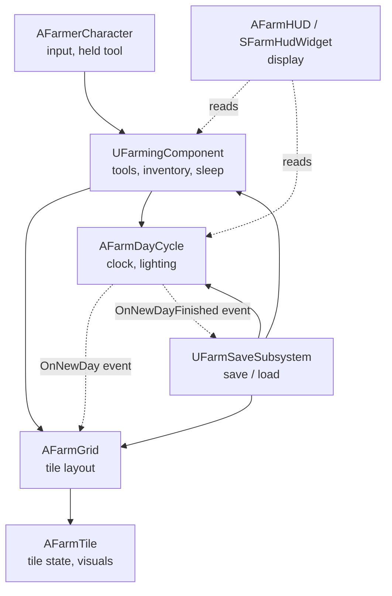
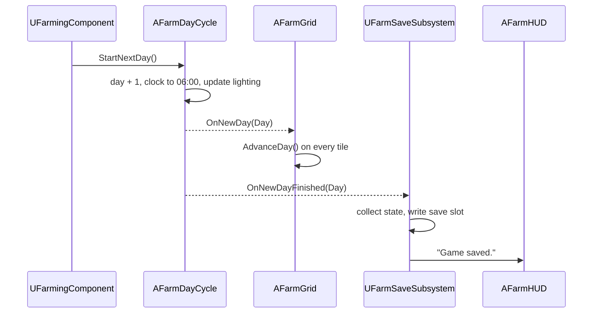

# Project Vestige architecture

How the game is put together and why. [CodingGuidelines.md](CodingGuidelines.md) covers how the code looks. This document covers how classes, systems and data fit together.

It has three parts:

- **Part A: principles.** General architecture practice for C++ and Unreal Engine games. These hold for any project.
- **Part B: Project Vestige's design.** How this project applies them today: the systems, who owns what, and how data flows.
- **Part C: decisions.** A log of the design choices we made and why, plus known gaps and the changes we expect to make.

Keep Part B and Part C up to date. When a change adds a system, moves a responsibility or makes a design choice, update this document in the same commit.

Contents

- Part A: principles
  1. [Core principles](#1-core-principles)
  2. [Unreal's gameplay framework: where things go](#2-unreals-gameplay-framework-where-things-go)
  3. [Lifetimes and initialization order](#3-lifetimes-and-initialization-order)
  4. [How systems talk to each other](#4-how-systems-talk-to-each-other)
  5. [Data and content](#5-data-and-content)
  6. [Saving](#6-saving)
  7. [Presentation: UI, audio and effects](#7-presentation-ui-audio-and-effects)
  8. [C++ and Blueprints](#8-c-and-blueprints)
  9. [Modules and plugins](#9-modules-and-plugins)
  10. [Performance by design](#10-performance-by-design)
  11. [Patterns borrowed from Lyra](#11-patterns-borrowed-from-lyra)
  12. [Designing for mods](#12-designing-for-mods)
- Part B: Project Vestige's design
  13. [Systems and ownership](#13-systems-and-ownership)
  14. [Dependencies](#14-dependencies)
  15. [The day flow](#15-the-day-flow)
- Part C: decisions
  16. [Decision log](#16-decision-log)
  17. [Known gaps](#17-known-gaps)
  18. [Expected changes](#18-expected-changes)

---

# Part A: principles

## 1. Core principles

1. **One job per class.** Every actor, component and subsystem has one responsibility, and every piece of logic, component and setting lives on the class whose job it is. Never put something on a class because that class is convenient or already in the level. If nothing fits, create a new class.
2. **One source of truth.** Every piece of game state has exactly one owner. Everything else reads it or asks the owner to change it. Copies of state drift apart.
3. **Dependencies point one way.** Lower layers never know about higher ones (see [section 14](#14-dependencies)). Game rules don't know about UI, sound or effects. Data doesn't know about the systems that use it.
4. **Rules apart from presentation.** The code that decides what happens (a crop grows) is kept apart from the code that shows it (a bigger mesh). Rules can then be tested without a level, and visuals can change without touching rules.
5. **Composition over inheritance.** Build actors from components. Keep inheritance shallow: an engine base class, then at most one or two of our own levels.
6. **Data-driven content.** Content (crops, tools, items) is described in data, not in code branches. Adding a crop should mean adding an asset, not editing a `switch`.
7. **Make wrong states impossible.** Model state with enums and private members that only change through functions that check transitions (`AFarmTile::Plant` refuses anything but tilled soil). Don't use loose booleans that can contradict each other.
8. **Commands go down, events go up.** A class calls functions on the things it owns or uses. Those things report back by broadcasting events, never by calling up into their users.
9. **The simplest design that works.** Don't build for features we don't have. Add a pattern when a real need appears, and write down why in the [decision log](#16-decision-log).

## 2. Unreal's gameplay framework: where things go

Unreal already has a home for most kinds of logic. Use it before inventing one.

| Class | Lifetime | Put here | Don't put here |
|---|---|---|---|
| `UGameInstance` and its subsystems | The whole run of the game, across map changes | Settings, the player profile, which save slot is active, music that plays across maps | Anything tied to one world |
| `AGameModeBase` | One world | The authoritative rules of the game in this world: default classes (pawn, HUD, controller), spawning, win/lose conditions | State the UI needs to read (in multiplayer it exists only on the server) |
| `AGameStateBase` | One world | Shared state of the world everyone may read: season, weather, calendar | Per-player state |
| `APlayerController` | One world, per player | The player's will: input routing, UI ownership, camera | The body's abilities or game rules |
| `APlayerState` | One world, per player, survives the pawn being destroyed | Per-player data that outlives the body: money, inventory, relationships | Things that need the body in the world |
| `APawn` / `ACharacter` | Until destroyed | The body: movement, animation, what it holds, abilities that need a position | Data that should survive the pawn |
| `UActorComponent` | Same as its actor | Reusable behavior: farming, inventory, interaction, health | Behavior only one actor will ever have (put it on that actor) |
| `AHUD` | One world, per player | Hosting the UI | Game state |
| `UWorldSubsystem` | One world | World-wide services with no transform: saving the world's state, lookups, registries | Settings that need tweaking per level; state that must survive a map change |
| `UGameInstanceSubsystem` | Whole run | Services that survive map changes | World-specific state |
| `ULocalPlayerSubsystem` | Per local player | Per-player UI, input and camera services | Shared state |
| `UDeveloperSettings` | Config | Project-wide tunables shown in Project Settings | Per-instance values |
| `UPrimaryDataAsset` | Asset | Definitions of content: a crop, a tool, an item | Runtime state |
| `USaveGame` | Save file | The saved data layout | Logic |

**World, map and level.** A *world* (`UWorld`) is the running game: one persistent map plus any sublevels streamed into it. The lifetimes above are world lifetimes, not sublevel lifetimes:

- **Streaming a sublevel** in or out only adds or removes that sublevel's actors. The world, its subsystems and the framework actors stay.
- **Opening a map** (`OpenLevel`, or non-seamless travel) tears the whole world down and creates a new one, with new world subsystems and framework actors. Only the game instance and its subsystems survive.
- **Seamless travel** also creates a new world, but carries a chosen set of actors (by default the game mode, game state, player controllers and player states) across through a transition map.

Project Vestige today has one map, no level streaming, and no travel except `OpenLevel` on the same map to start a new game. Revisit this section and [section 13](#13-systems-and-ownership) before adding any of them.

A useful test for player data: **does it need to exist when the player's body doesn't?** Money and inventory do, so they belong on the player state (or a component on it). Tool use needs a position and facing, so it belongs on the pawn.

Placed actors versus subsystems: use an actor when something needs a place in the level or per-level settings a designer tweaks in the Details panel. Use a subsystem when it's a service that should always exist and needs no settings.

A placed actor that the game can't run without may **find-or-spawn** itself through a static `Get(UWorld*)` (`AFarmDayCycle::Get`), so a level that's missing it still runs. This is a convenience with side effects, so it follows these rules:

- **World-scoped and game-thread only.** `Get` takes the world it works in and never caches an instance across worlds.
- **Only in a running game world.** It spawns only in game and Play in Editor worlds that have begun play and aren't being torn down. Anywhere else (editor and preview worlds, teardown) it returns what `Find` returns, possibly null, and callers handle null.
- **One creation authority.** `Get` is the only code that spawns the actor. Everything else calls `Get` or `Find`.
- **Bad level setup is visible, not hidden.** Spawning a missing instance logs a warning, and finding more than one logs an error and uses the first. A level that needs designer settings on the actor should place it rather than rely on the fallback.
- **Actors only.** A service with no transform or per-level settings belongs in a subsystem, which Unreal creates exactly once per world; don't copy this pattern for it.

## 3. Lifetimes and initialization order

Most hard-to-find Unreal bugs are about things running in a different order than assumed.

- **Constructors** run for the class default object at editor startup, with no world. Only create components and set defaults there. Never spawn, search the level or bind to other actors in a constructor.
- **`OnConstruction`** runs in the editor whenever a placed actor changes. Use it for editor previews (`AFarmGrid` sizes its bounds box), never for gameplay.
- **`PostInitializeComponents`** runs before `BeginPlay`, once the actor's own components exist. Use it to wire an actor's own components together.
- **`BeginPlay`** is where gameplay setup starts. **The order between different actors' `BeginPlay` calls is not guaranteed.** Never assume another actor has already run its `BeginPlay`.
- **`EndPlay`** runs when the actor is destroyed, when the sublevel it lives in is streamed out, or when the world is torn down. Unbind delegates and remove UI here.
- **World subsystems**: `Initialize` runs when the world is created, `OnWorldBeginPlay` before the actors' `BeginPlay`, and `Deinitialize` when it is torn down.
- **Opening a map** destroys the world and everything in it: actors, components and world subsystems. Only the game instance and its subsystems survive. Streaming a sublevel doesn't; see [section 2](#2-unreals-gameplay-framework-where-things-go) for the difference.

To deal with unknown order, in order of preference:

1. **Find-or-spawn on demand.** A static `Get(World)` that returns the existing instance or creates it (`AFarmDayCycle::Get`), under the rules in [section 2](#2-unreals-gameplay-framework-where-things-go). Only for required placed actors.
2. **Register with a known owner.** Things announce themselves to a subsystem in their `BeginPlay`, and the subsystem broadcasts once everything it needs has arrived.
3. **Wait for a signal.** Bind to a "ready" event rather than guessing.
4. **Wait a tick** (`SetTimerForNextTick`). This works but hides the dependency. Use it only when the above don't fit, and comment why.

## 4. How systems talk to each other

Pick the loosest connection that does the job.

| Mechanism | Use when | Example |
|---|---|---|
| Direct function call | A class tells something it owns or clearly depends on to do something | `UFarmingComponent` calls `AFarmTile::Till` |
| Multicast delegate | Something happened and any number of others may care. The sender must not know who listens | `AFarmDayCycle::OnNewDay` |
| Interface (`UINTERFACE`) | Many unrelated classes respond to the same request | A future `IFarmInteractable` for tiles, chests and NPCs |
| Subsystem lookup | Reaching a global service | `GetWorld()->GetSubsystem<UFarmSaveSubsystem>()` |
| Message bus (Lyra's Gameplay Message Router) | Many senders and many listeners that shouldn't know each other at all | Not needed yet |

Rules:

- **No circular dependencies.** If A calls B, B doesn't call A. B broadcasts an event that A listens to.
- **Ask, don't reach in.** Never change another class's state directly. Call a function that says what you want; the owner keeps itself consistent.
- **Find things in one place.** Each well-known object has one static `Find` / `Get` function. Don't scatter `TActorIterator` searches through the code.
- **Bind with object-safe helpers** (`AddUObject`, `AddWeakLambda`) so a destroyed listener is never called, and unbind in `EndPlay` / `Deinitialize`.
- **C++-only events use non-dynamic delegates.** Use dynamic delegates only when Blueprints need to bind.

## 5. Data and content

| Kind of data | Use | Notes |
|---|---|---|
| A definition of one piece of content with assets attached (a crop with meshes and growth days) | `UPrimaryDataAsset` subclass | One asset per crop. The Asset Manager can find and load them all. |
| Many rows of the same numbers, edited like a spreadsheet (prices, balancing) | `UDataTable` with a `USTRUCT` row | Can be imported from CSV |
| Project-wide tunables | `UDeveloperSettings` | Shows up in Project Settings, stored in `Config/` |
| Per-class tunables | `EditDefaultsOnly` properties, set in a Blueprint subclass | How `AFarmTile`'s meshes are set today |
| Per-placed-instance tunables | `EditAnywhere` properties | `AFarmGrid` size |
| Open-ended categories designers extend | `FGameplayTag` | Item categories, seasons |
| Small closed sets that code switches on | `enum class` | `EFarmTool`, `EFarmTileState` |

- **Identify content by stable IDs**, not by pointers, array positions, asset paths or display names. This matters most for saves: an ID still means the same thing after content is added, reordered, renamed or moved.
- **One canonical content ID.** Every content data asset has a `ContentId` property, an `FName` of the form `<Namespace>.<Name>` (`Base.Turnip`). It is typed in by whoever makes the asset; it is not derived from the asset's file name or path, so renaming or moving the asset doesn't change it. The asset's `FPrimaryAssetId` is built from it (the data asset overrides `GetPrimaryAssetId` to return its type and `ContentId`), so the Asset Manager and saves use the same ID. This ID is what saves store.
  - **Format:** exactly one dot; namespace and name are PascalCase ASCII letters and digits. Base content uses the namespace `Base`; a mod uses its own name. Data validation (`IsDataValid`) rejects an asset with a missing or badly formed ID.
  - **IDs never change once a build has shipped.** Fix a display name instead; that's a separate localized `FText`. If an ID really must change, add an old-to-new entry to an ID redirect list that loading applies before looking content up.
  - **Duplicates are errors.** At startup the game checks every content type for repeated IDs and logs an error naming both assets. Base content wins over mods; between two mods, the first one loaded wins until mod load order exists ([section 12](#12-designing-for-mods)).
  - **Unknown IDs** in a save are skipped with a logged warning, and the player is told some content couldn't be found ([section 12](#12-designing-for-mods), rule 6).
  - **Tests** cover a redirected ID, a duplicate ID and an unknown ID before saves rely on content IDs.
- **Gameplay tags** identify open-ended categories (item categories, seasons), not individual pieces of content.
- **Reference assets softly** (`TSoftObjectPtr`) when they don't have to be in memory with the referencing class. Hard references load everything they point to.
- **Code never hard-codes paths to our own assets.** Expose a property and set it in a Blueprint subclass, a data asset or config. Engine default assets (`/Engine/BasicShapes/...`) are fine as placeholders.

## 6. Saving

- **Each owner saves its own state.** An owner provides a function that returns a plain save struct (`FFarmTileSaveData`) and one that restores from it. The save subsystem collects and stores these structs. It doesn't read or write other classes' internals.
- **Save data is plain structs** of IDs and values. No object pointers.
- **Version the save.** The save game has a version number, raised whenever the layout changes, with a migration step from each older version.
- **Never lose the player's save by accident.** Only an explicit choice by the player (starting a new game) deletes or replaces a save that couldn't be loaded. What loading does:

| What's in the slot | Outcome |
|---|---|
| Nothing | Start a new game. No message needed. |
| A save of the current version | Load it. |
| An older version that migrates | Load the migrated data. Before the first save in the new format overwrites it, keep a copy of the original file next to it. |
| A corrupt file, a newer version than this build understands, or an older version whose migration fails | Don't load it and don't crash. Tell the player and log why. Leave the file untouched: saving stays off for the rest of the session, so a fresh day can't overwrite it. The player can start a new game, which is the explicit decision to replace it. |
| Content IDs this build doesn't know | Load the rest, skip those entries with a warning ([section 12](#12-designing-for-mods), rule 6). |

- **A failed write keeps the last good save.** Write the new save beside the old one and replace the old one only when the write succeeded; tell the player if it failed. The game carries on and tries again at the next save point.
- **Save at clear points.** We save when a new day starts. That keeps saves consistent: nothing is half-done mid-action. The accepted cost: quitting mid-day loses everything since that morning. Saving is synchronous (`SaveGameToSlot`), which is fine while saves are small; move to `AsyncSaveGameToSlot` if writing a save causes a visible hitch.
- **One world, one slot.** Today the save subsystem lives in the world ([section 2](#2-unreals-gameplay-framework-where-things-go)) and uses one fixed slot. Before adding save slots, a main menu or map travel, split it: choosing and remembering the active slot moves to a `UGameInstanceSubsystem` (it must survive the world being replaced), and collecting and applying the world's snapshot stays in the world subsystem. Never open another map while a save is being written; with synchronous saves this can't happen yet.
- **Restore without side effects.** Restoring sets state directly; it doesn't replay game actions or broadcast "new day" again (`AFarmDayCycle::RestoreClock`).
- **Test the save rules.** Save tests cover a save and load round trip through each owner's own save and restore functions, migration from every older version, a corrupt and a newer-version file being left untouched, and unknown content being skipped.

## 7. Presentation: UI, audio and effects

- **Presentation depends on the game; the game doesn't depend on presentation.** UI, sounds and effects read state and listen to events. Game rules never call the UI, an audio component or a particle system directly.
- **The UI owns no game state.** It may keep display-only state, such as a message that is fading.
- **Cosmetics react to events.** When a tile is watered, the tile broadcasts a change and cosmetic code plays the splash. Gameplay code doesn't spawn the splash itself.
- **UI technology grows with the UI.** A small HUD in C++ Slate needs no assets. Once there are menus and inventories that need designing visually, move to UMG Widget Blueprints with C++ base classes. Look at Common UI only when we need controller navigation and layered menus.

## 8. C++ and Blueprints

The usual Unreal split, and Epic's own recommendation, is **C++ for systems, Blueprints for content**.

- **C++:** game rules, systems, data definitions, anything we test, anything that runs every frame or over many objects, and the base classes Blueprints extend.
- **Blueprints:** assigning assets (meshes, materials, sounds), tuning values, level layout and one-off level scripting, visual-only behavior like animation and effects timing.
- C++ classes are the base; Blueprint subclasses (`BP_...`) fill in assets and values. Code references the C++ class and gets the Blueprint through a `TSubclassOf` property (as `AFarmGrid::TileClass` does), never by asset path.
- If Blueprint logic grows past a handful of nodes, or two Blueprints duplicate it, move it to C++.

## 9. Modules and plugins

- The game is a **single runtime module** (`Vestige`). That's right for a project this size.
- Add a separate module only for a concrete reason:
  - **`VestigeEditor`** (editor-only module): when we write editor tools, validators or custom detail panels, which must not ship in the game.
  - **`VestigeTests`**: if the tests outgrow `Source/Vestige/Tests/`.
  - **A plugin**: for a system that's finished, self-contained and reusable in another project.
- Module dependencies are one-way and listed in `.Build.cs`. Prefer private dependencies.

## 10. Performance by design

Don't optimize early, but don't choose designs that can't scale either.

- **Ticking is opt-in.** Most things react to events or timers. Only things that genuinely change every frame tick (`AFarmDayCycle` moves the sun).
- **Event-driven daily updates.** Farm logic mostly happens once a day, on `OnNewDay`. Nothing needs to check crops every frame.
- **Change structure when a profile says so, not at a tile count.** One actor per tile is the current design and stays until profiling shows tiles are a real cost. If they are, look at what is expensive (CPU, memory, collision, draw calls) and pick the fix that targets it. Options to weigh include keeping tile state in an array of structs owned by the grid, drawing tiles with instanced static mesh components (which changes how tiles are drawn, not their rules or collision), and merging collision. Keeping tile rules out of tile visuals ([principle 4](#1-core-principles)) keeps all of these open.
- **Measure before optimizing.** Use `stat unit`, `stat game` and Unreal Insights to find real costs.

## 11. Patterns borrowed from Lyra

Lyra is Epic's reference for a well-structured UE5 game. It is built for a large team and multiplayer, so **we adopt a Lyra pattern when we have a concrete need for it, not before.**

| Lyra pattern | Status in Project Vestige |
|---|---|
| Thin actors, behavior in components (`ULyraHealthComponent`, `ULyraHeroComponent`) | **Adopted.** `AFarmerCharacter` is a template character plus `UFarmingComponent`. New abilities (fishing, stamina) become new components. |
| Subsystems instead of singletons and managers | **Adopted.** `UFarmSaveSubsystem`. |
| A project prefix on every class (`Lyra...`) | **Adopted.** `Farm...` |
| Data assets describing content (`ULyraPawnData`) | **Adopted** for crops (`UFarmCropData`). **Planned** for tools and items. |
| Gameplay tags for identifiers | **Later**, for open-ended categories. Closed sets stay enums. |
| Input actions mapped to tags through data assets | **Later.** Input actions are created in code today. Move to `IA_` / `IMC_` assets when input grows. |
| Gameplay Message Router | **Not yet.** Plain delegates are enough. |
| Game Feature plugins and modular gameplay actors (actors that accept components from plugins) | **Later**, as a likely building block for mod loading ([section 12](#12-designing-for-mods)). |
| Gameplay Ability System, Experiences, Common UI, replication | **Not adopted.** Each adds a lot of setup that a single-player prototype doesn't need. Revisit when a feature calls for one. |

## 12. Designing for mods

**Goal: other people can add content and behavior to the game without our source code.**

**Status: mod-oriented design, not mod support.** The game can't load mods today, and nothing in it is a promised mod API yet. We follow the rules below so mod loading can be added later without a rewrite.

### How Unreal games are modded

- A mod is usually a **plugin**: content (meshes, data assets, Blueprints) plus, rarely, C++. Unreal doesn't discover, mount or activate plugins added to a packaged game on its own; the game has to do that, and the plugin's content has to be cooked for the same engine version.
- **Content and Blueprint mods** are the kind we design for. C++ mods have to be compiled against exactly the same engine version and build as the game, which is fragile; we don't plan for them.
- Lyra's **Game Feature plugins** are a likely building block. A Game Feature can add data assets, add components to existing actors and register gameplay tags without the base game knowing it exists. They aren't a mod loader, though: the game has to register and activate each one through the Game Features subsystem, and deactivation, dependencies and their lifecycle are ours to design.
- The best way to keep the game moddable is to **build the base game the way a mod would be built**: base content goes through the same discovery, IDs and extension points a mod would use.

### Rules from now on

1. **Content is discovered, not listed.** Crops, tools, items, recipes and shop stock are data assets of a registered primary asset type (for example `FarmCrop`). The game asks the Asset Manager for every asset of that type. There are no hard-coded lists or `switch` statements over content, so a mod adds a crop by adding a data asset.
2. **Enums only for fixed mechanics.** An `enum class` is fine for states that mods shouldn't extend, like `EFarmTileState` (grass, tilled, planted). Anything a modder might want more of (tools, crops, item categories) is a data asset or a gameplay tag.
3. **Namespaced IDs.** Every piece of content has a stable `ContentId` of the form `<Namespace>.<Name>`, with the format, rename and duplicate rules in [section 5](#5-data-and-content). Base game content uses `Base` (`Base.Parsnip`, `Base.WateringCan`). Mods use their own name. Gameplay tags we define live under `Farm.`; mods add their own.
4. **Deliberate extension points.** Key classes are `Blueprintable`. Meaningful moments get Blueprint-assignable events or `BlueprintNativeEvent` hooks (a crop is harvested, a new day starts, a tool is used). Main actions are `BlueprintCallable`. Mark these with `/** Extension point: ... */` in the header. Everything else stays private, because every exposed function is a promise to modders.
5. **Behavior in components, and actors that tolerate extra ones.** A mod adds behavior by adding a component to an existing actor. Actors must not assume they have a fixed set of components, and systems should look for components and interfaces rather than concrete classes.
6. **Saves survive missing content.** Saves store content IDs, never positions in a list. When a save mentions content that no longer exists (a mod was removed), loading skips it with a warning instead of failing.
7. **No hard asset paths in code**, as in [section 5](#5-data-and-content). Mods can only replace or extend what goes through properties, data assets and the Asset Manager.

### Before we say the game supports mods

All of these have to exist and be tested in a packaged build first:

- **Discovery and mounting:** finding mod plugins in a mods folder of a packaged build and mounting their cooked content.
- **Asset Manager scanning:** the primary asset types are configured to scan plugin content, so a mod's data assets are found like base content.
- **Activation:** turning a mod on and off, and what happens to its content in a running game.
- **Load order and conflicts:** which mod wins, and how duplicate content IDs are reported ([section 5](#5-data-and-content)).
- **Versions:** which game versions a mod works with, and what happens when it doesn't.
- **Saves without the mod:** a save made with a mod loads without it ([section 6](#6-saving)).
- **Trust and consent:** mods run with the player's trust (a Blueprint mod can do anything the game can), so the player turns each mod on knowingly, and the game never runs mods from untrusted sources automatically.
- **A documented mod API:** which classes, events and functions are extension points (rule 4).

### What we leave for later

- Everything in the list above.
- Moving base content into its own Game Feature plugin.
- A mod kit: the editor setup modders would build with.
- Letting mods override base content rather than only add to it.

---

# Part B: Project Vestige's design

## 13. Systems and ownership

| Class | Kind | Owns | Does not own |
|---|---|---|---|
| `AFarmTile` | Actor | One tile's state (grass, tilled, planted, watered, growth, the crop planted in it) and its visuals | Crop definitions, time, input, saving |
| `AFarmGrid` | Actor, placed in the level | Spawning tiles, finding a tile by location, advancing tiles on a new day | The clock, lighting, the day number |
| `AFarmDayCycle` | Actor, placed or found-or-spawned by `Get` ([section 2](#2-unreals-gameplay-framework-where-things-go)) | Day number, clock, sun and sky light, night exposure. Broadcasts `OnNewDay`, then `OnNewDayFinished` | Tiles, saving, HUD |
| `UFarmingComponent` | Component on the farmer | Current tool, seeds and the crop they plant (`SeedCropId`, loaded at `BeginPlay`), harvest count, tile targeting, using a tool, sleeping and passing out | UI, input bindings, meshes |
| `AFarmerCharacter` | Character (parent of `BP_ThirdPersonCharacter`) | Input bindings and the held tool mesh | Farming rules |
| `AFarmHUD` + `SFarmHudWidget` | HUD + Slate widget | Display only. Reads from the day cycle and farming component; keeps fading messages | Any game state |
| `UFarmSaveSubsystem` | World subsystem | The current world's snapshot: saving it on `OnNewDayFinished` and loading it at play start, in the single save slot. Starting a new game (deletes that slot, then reopens the map) | Game rules; save slot or profile choice that must survive a map change ([section 6](#6-saving)) |
| `UFarmSaveGame` | Save game | The saved data layout | Logic |
| `UFarmContentData` | Abstract base of every content data asset | What all content shares: the `ContentId`, the primary asset ID built from it, the display name, the `Visuals` bundle name, and loading content with its visuals at play start | Anything specific to one kind of content |
| `UFarmCropData` | Primary data asset (type `FarmCrop`), one per crop in `Content/Farm/Crops` | One crop's definition: seasons, days to mature, water need, contamination tolerance, growth stage meshes (in the `Visuals` bundle), yield, seed and sell price | Runtime state such as growth or which tiles grow it |

When a new responsibility appears, decide its owner using [section 2](#2-unreals-gameplay-framework-where-things-go), add a row here, and say so in the commit message.

## 14. Dependencies

Arrows point from a class to what it knows about. Nothing points back up.

Layers, from bottom to top:

1. **Data**: `UFarmSaveGame`, content data assets (`UFarmContentData` and its subclasses), enums and structs.
2. **World state**: `AFarmTile`, `AFarmGrid`, `AFarmDayCycle`.
3. **Player actions**: `UFarmingComponent`.
4. **Services**: `UFarmSaveSubsystem`.
5. **Input and presentation**: `AFarmerCharacter`, `AFarmHUD`.

Lower layers broadcast events; they never include or call higher layers. Exceptions are listed in [Known gaps](#17-known-gaps).

## 15. The day flow

What happens when the player sleeps (N) or passes out at 02:00:

`OnNewDayFinished` exists so saving always runs after every system has reacted to the new day, whatever order they subscribed in. The day cycle broadcasts it as soon as the `OnNewDay` broadcast returns, so it only marks the end of work done **synchronously**. That's a contract for every `OnNewDay` listener:

- **Finish all changes to saved state inside the handler.** No timers, latent actions, async tasks or deferred spawns that change state the save captures.
- **Presentation may run later.** A crop-growth animation or a sound can play over the next seconds, because nothing about it is saved.
- **If a system ever needs asynchronous day work,** `OnNewDayFinished` stops being enough. Replace it with an explicit barrier first: each system reports pending work to the day cycle, and the day cycle signals that the day has finished only when every report is done. Save tests check the snapshot against whichever contract is in force.

At play start, `UFarmSaveSubsystem` waits one tick so the grid has spawned its tiles, then binds to the day cycle and loads the save if there is one.

---

# Part C: decisions

## 16. Decision log

Newest first. Add an entry whenever we make a choice that someone could reasonably have made differently. Never delete an entry; if a decision is reversed, add a new entry that says so.

| Date | Decision | Why |
|---|---|---|
| 2026-10-28 | `ContentId`, the display name, the primary asset ID and loading with the `Visuals` bundle moved from `UFarmCropData` into an abstract `UFarmContentData` base. Each content type only names its primary asset type | Tools are the second kind of content, and both need the same ID and loading code. One copy keeps the ID rules from [section 5](#5-data-and-content) in one place |
| 2026-10-28 | CQTest set up: a private `CQTest` dependency in builds with developer tools, and the first tests in `Source/Vestige/Tests/FarmTileTests.cpp` | Rule changes to the tile needed tests. Tying the dependency to developer tools keeps the developer module out of shipping builds |
| 2026-10-28 | The farming component owns which crop the seeds plant, as a `FPrimaryAssetId` (`SeedCropId`, set on the farmer Blueprint). It loads that crop with its `Visuals` bundle at `BeginPlay` and passes it to `AFarmTile::Plant`. A tile keeps a pointer to its crop while planted. The turnip's settings moved from `BP_FarmTile` to `DA_Crop_Turnip` (`Base.Turnip`). Harvests add the crop's yield. Saves still don't store crop IDs: planted tiles are restored with the seed crop | Choosing what to plant is a player action, and seeds already belong to the farming component. A seed or inventory system will replace the single ID later. Loading at play start means planting never waits on a load. Every crop planted so far is the seed crop, so old saves load unchanged; storing crop IDs is its own roadmap item |
| 2026-10-28 | Crops are `UFarmCropData` primary data assets of type `FarmCrop`, scanned in `/Game/Farm/Crops` and always cooked. The primary asset ID is `FarmCrop:<ContentId>`. Growth stage meshes are soft references in a `Visuals` asset bundle. Seasons are gameplay tags (`Farm.Season.*`). Growth stays one stage per watered day up to `DaysToMature`, with no separate day count per stage. Fields no system reads yet (seasons, water need, contamination tolerance, prices) have neutral defaults | Content is found by the Asset Manager, not listed in code. Crops nothing refers to are still cooked, so mods and shops can find them. Soft meshes load only for crops in use. Seasons are open-ended categories ([section 5](#5-data-and-content)). One stage per day matches the prototype; add per-stage days when a crop needs uneven stages. Defining every field now means later systems only fill in data |
| 2026-10-28 | Game module, targets and project file renamed from `FarmSim` to `Vestige` (`Vestige.uproject`, `VestigeEditor`, `VESTIGE_API`, `LogVestige`, `AVestigeCharacter`/`GameMode`/`PlayerController`); the `Farm`-prefixed gameplay types, `Content/Farm/`, `L_Farm` and the save slot keep their names; `[CoreRedirects]` in `DefaultEngine.ini` map `/Script/FarmSim` to `/Script/Vestige` | The project's codename is now Project Vestige. Renaming the gameplay types too would touch every class, asset reference and doc for no gain; the `Farm` prefix still describes what they are. The redirects keep Blueprints, `L_Farm` and existing save files that name the old module loading |
| 2026-10-28 | Licensing tightened after the licensing audit: contributors' grant to the maintainer narrowed so official builds stay GPL (no closed-source versions, by anyone); the Unreal/platform permission moved into `LICENSE-EXCEPTION.txt` and applies to later GPL versions too; SPDX headers in our source files; a path-level license table in `LICENSING.md`; contributions only as pull requests with a ticked terms box; a list of accepted third-party licenses | Matches the stated goal that nobody ships a closed-source FarmSim, keeps the permission attached to every copy of the code, and gives a recorded rights chain for selling builds. Commercial asset use stays reserved to the maintainer on purpose. Still needs a lawyer's check |
| 2026-10-28 | One canonical content ID: a typed-in `ContentId` (`<Namespace>.<Name>`) on each content data asset, used for the `FPrimaryAssetId` and in saves; IDs never change after shipping (redirects if they must), duplicates are startup errors, base content wins | An ID derived from an asset's name or path changes when the asset is renamed or moved, which would break saves and mods. Settled before the first crop asset exists |
| 2026-10-28 | A save that can't be loaded is never overwritten without the player starting a new game; a failed write keeps the last good save; quitting mid-day loses that day's progress | Treating an unreadable or newer save as a clean start would turn a fixable problem into lost progress. Saving only at day start keeps saves consistent, and the loss window is an accepted trade-off for now |
| 2026-10-28 | Save subsystem scope is one world and one slot; slot and profile choice move to a game-instance subsystem before save slots, menus or map travel arrive | A world subsystem is recreated with every new world, so anything that must survive a map change can't live there |
| 2026-10-28 | `OnNewDay` listeners finish changes to saved state synchronously; an explicit completion barrier replaces `OnNewDayFinished` if that ever changes | `OnNewDayFinished` only follows synchronous work. Without the contract a save could capture a half-advanced day |
| 2026-10-28 | Find-or-spawn (`Get`) only spawns in a running game world, is the only creator, and warns when it spawns or finds duplicates; subsystems are used instead for services | The fallback should keep a level running without hiding a broken level setup or spawning into editor or dying worlds |
| 2026-10-28 | Mod support described as a design goal with a readiness checklist, not as a supported feature | Data-driven rules alone don't make plugin content loadable in a packaged build; contributors shouldn't build against a mod API that doesn't exist |
| 2026-10-26 | Removed the template's unused code and content: the Combat, Platforming and SideScrolling variants, `LevelPrototyping`, `Lvl_ThirdPerson` and mannequin assets nothing references. Kept only what `L_Farm` and the third person Blueprints use | Keeps the public repository small and clear, and limits how much Epic template material we redistribute. Drops the AI and StateTree dependencies |
| 2026-10-26 | Code under GPL-3.0-or-later with an Unreal Engine linking permission; assets under CC BY-NC-SA 4.0; contributors grant the maintainer commercial use (see `LICENSING.md`) | Open for contributors and modders, no closed-source forks, and only the maintainer sells complete builds. The linking permission is needed because the engine isn't free software |
| 2026-10-26 | Design for content and Blueprint mods; don't build mod loading yet | David wants the game to be easy to mod later. Following the rules in [section 12](#12-designing-for-mods) costs little now; retrofitting them later would mean rewriting content and saves |
| 2026-10-26 | Architecture documented here; code style in `CodingGuidelines.md` | Keep "how it fits together" apart from "how code looks" |
| 2026-10-25 | Adopt CQTest for game-rule tests; setup is pending (see the Tests checklist in [Roadmap.md](Roadmap.md)) | Epic's newest C++ test framework; simpler than Automation Spec |
| 2026-10-25 | Save in a `UWorldSubsystem`, written when a new day starts | Saving is a world-wide service with no transform. A new world means a fresh subsystem, so a new game is "delete save, reopen the map". Saving at day start keeps saves consistent |
| 2026-10-25 | HUD is an `AHUD` hosting a C++ Slate widget | No widget assets to maintain for a tiny HUD. Revisit with UMG when menus arrive |
| 2026-10-25 | Clock, lighting and night exposure moved from `AFarmGrid` to a new `AFarmDayCycle` | The grid's job is tiles. Time has its own owner, which the grid listens to |
| 2026-10-25 | `AFarmDayCycle` is found or spawned on demand | The game works even in a level where nobody placed one |
| 2026-10-25 | Input actions created in code | No input assets needed while there are only a few keys |
| 2026-10-25 | Farming lives in `UFarmingComponent`, not in the character | Composition: the character stays a body with input |
| 2026-10-25 | Single-player only, no replication | A solo prototype. Designing for multiplayer would cost a lot of complexity now |
| 2026-10-25 | Unreal Engine 5.7, C++ first, Blueprints for content; one game module | Developer knows C++; Epic's recommended split |

## 17. Known gaps

Places where the current code doesn't follow Part A yet. Fix them when working nearby, each in its own commit, and remove the line when it's done. Code-style gaps are listed in [CodingGuidelines.md](CodingGuidelines.md#16-known-deviations-to-clean-up).

- **Game logic calls the HUD.** `UFarmingComponent` and `UFarmSaveSubsystem` call `AFarmHUD::ShowMessage` directly, so gameplay depends on presentation. Replace with a feedback event (for example an `OnFarmMessage` delegate on a small subsystem) that the HUD listens to.
- **The save subsystem reads and writes other classes' state.** It sets `UFarmingComponent::Seeds` directly and pulls tile fields one by one. Give each owner its own save and restore functions that use its save struct ([section 6](#6-saving)).
- **Content IDs aren't checked yet.** `UFarmContentData::ContentId` has no format validation, duplicate check or redirect list ([section 5](#5-data-and-content)). A content asset with an empty ID has no valid primary asset ID, so the Asset Manager doesn't register it.
- **Tools are a hard-coded enum** (`EFarmTool`), so new tools need code changes. Replace with tool data assets ([section 12](#12-designing-for-mods)).
- **No extension points.** Nothing is exposed to Blueprints yet, and the C++ delegates can't be bound from Blueprints.
- **Saves don't record a tile's crop.** `UFarmSaveSubsystem` restores every planted tile with the farming component's seed crop. That is correct only while there is one crop. Save the crop's `ContentId` per tile ([section 6](#6-saving)).
- **Tiles are saved by grid position.** If the grid size changes, saved tiles land in the wrong place. Save each tile's grid coordinates (or an ID) with its data.
- **No save version number** in `UFarmSaveGame`.
- **An unreadable save gets overwritten.** When loading fails, `UFarmSaveSubsystem` shows a message but still saves on the next new day, replacing the file it couldn't read. Turn saving off for the session instead ([section 6](#6-saving)). A failed write may also leave no good save, since `SaveGameToSlot` writes over the old file.
- **`AFarmDayCycle::Get` doesn't follow the find-or-spawn rules yet** ([section 2](#2-unreals-gameplay-framework-where-things-go)). It spawns in any world without checking the world type or teardown, and logs nothing when it spawns or when the level has more than one.
- **Load waits a tick** for the grid to spawn tiles ([section 3](#3-lifetimes-and-initialization-order)). Better: the grid broadcasts when its tiles are ready, or registers with the save subsystem.
- **The grid is found with `TActorIterator` in several places.** Add `AFarmGrid::Find(const UWorld*)` like `AFarmDayCycle::Find`.
- **Tile rules and visuals live in the same class.** Fine for now. Separate them (a plain tile-state struct the actor owns) before writing tile tests or growing the field a lot.

## 18. Expected changes

Likely next steps as the game grows, with the design we intend. These aren't commitments; record the real decision in the log when we get there.

- **Inventory and money** move off the pawn into an inventory component on the player state, because they must outlive the body ([section 2](#2-unreals-gameplay-framework-where-things-go)).
- **Tools and items** become data assets (`UFarmToolData`, `UFarmItemData`) found through the Asset Manager, like crops (`UFarmCropData`) already are. Tiles, the farming component and saves refer to content by its `ContentId` ([section 5](#5-data-and-content)). `EFarmTool` goes away.
- **Save slots, a main menu or map travel** split the save subsystem: the active slot moves to a `UGameInstanceSubsystem`, and the world subsystem keeps collecting and applying the world's snapshot ([section 6](#6-saving)).
- **Interaction** (doors, chests, NPCs, shipping bin) goes through an `IFarmInteractable` interface, so the farmer's interact key doesn't need to know every type.
- **Seasons and weather** belong to the game state, or to the day cycle if they stay small. They broadcast changes like `OnNewDay`.
- **Menus and inventory UI** move to UMG Widget Blueprints with C++ base classes.
- **Source folders** split by feature once there are about 20 of our own files (see [CodingGuidelines.md](CodingGuidelines.md#141-source)).
